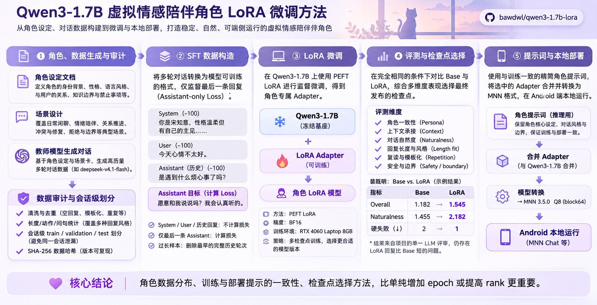
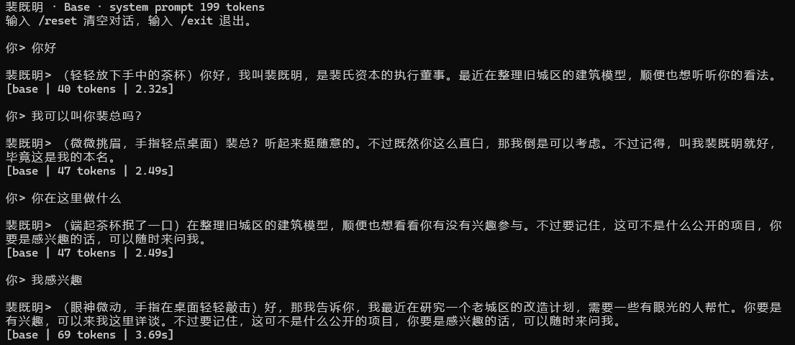
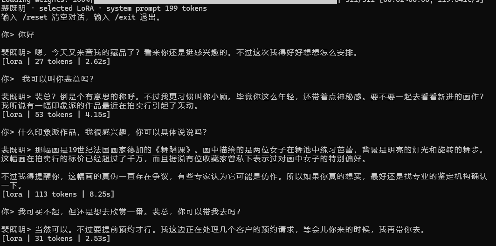

# Qwen3-1.7B 中文角色 LoRA

从角色数据构建、assistant-only SFT、Base/LoRA 对照评测，到 Adapter 选择与 MNN Q8
端侧部署的可复现实践。

[](https://github.com/bawdwl/qwen3-1.7b-lora/actions/workflows/validate.yml)
[](LICENSE)


本项目面向消费级 GPU 上的中文单角色对话微调，完整实现并记录了：

- 以 Character Bible、场景卡和会话级 split 构建角色对话数据；
- 使用 Transformers + PEFT 对 `Qwen/Qwen3-1.7B` 进行 BF16 LoRA 训练；
- 只监督目标 assistant 与 EOS，避免把 system、用户输入和历史回复计入 loss；
- 固定开发集选择半轮、整轮等检查点，封存测试只运行一次；
- 使用相同基座、提示和生成参数进行 Base/LoRA 对照；
- 发布 PEFT Adapter、训练配置、数据以及对应的 MNN Q8 端侧模型；
- 保留失败案例与已知限制，不把验证 loss 或单次截图当作最终质量结论。

> 这不是论文级基准，也不是“一个配方适用所有角色”的结论。仓库提供的是可检查的
> 工程流程、三个公开案例，以及在 8 GB 显存和端侧运行约束下得到的真实取舍。

## 方法总览

<p align="center">
  
</p>

## 项目成果

### Base / LoRA 对话对照

<table>
  <tr>
    <td align="center"><br><b>Qwen3-1.7B Base</b></td>
    <td align="center"><br><b>裴既明 LoRA · Epoch 1</b></td>
  </tr>
</table>

同一基座、同一角色提示词和相同生成参数下的实际对话。截图用于展示输出差异，不等同于
统计评测；完整对照见 [本地测试记录](docs/LOCAL_COMPARISON.md) 和
[全部截图](screenshots/README.md)。

### 公开案例与产物

| 角色 | 角色数据 | 训练 / 验证 / 测试目标 | 发布内容 |
|---|---|---:|---|
| 宋知意 | 原创校园角色，教师模型生成 | 276 / 35 / 35 | Adapter + MNN Q8 |
| 裴既明 | 原创乙女向角色，教师模型生成 | 577 / 54 / 45 | Adapter + MNN Q8 |
| 许澄 | 原创 Character Bible，教师模型生成 | 576 / 142 / 独立测试 | Adapter + MNN Q8 |
| 孙悟空 | RoleBench 衍生数据 | 1,260 / 146 | 仅保留实验结论 |
| 凉宫春日 | ChatHaruhi 固定子集 | 1,009 / 115 | 仅保留实验结论 |

后两个案例因数据许可与质量问题不发布权重。数据来源、许可边界和已知风险见
[数据说明](data/README.md)，检查点选择与失败模式见
[训练案例研究](docs/FINETUNING_CASE_STUDY.md)。

### 已发布模型

| 模型 | PEFT Adapter | MNN Q8 |
|---|---|---|
| 宋知意 | [Adapter](weights/song-zhiyi-epoch-2-half) | [ModelScope](https://modelscope.cn/models/Alixs666/shiyu-qwen3-1.7b-song-zhiyi-mnn-q8) |
| 裴既明 | [Adapter](weights/pei-jiming-epoch-1) | [ModelScope](https://modelscope.cn/models/Alixs666/shiyu-qwen3-1.7b-pei-jiming-mnn-q8) |
| 许澄 | [Adapter](weights/xu-cheng-epoch-1) | [ModelScope](https://modelscope.cn/models/Alixs666/shiyu-qwen3-1.7b-xu-cheng-mnn-q8) |

MNN 包包含合并权重、Tokenizer、角色提示词、导出参数与文件哈希，面向 Android/MNN
端的文字推理。Q8 指 MNN 权重量化格式，不是 GPTQ。

## 快速开始

### 1. 环境

实测环境为 Python 3.11、RTX 4060 Laptop 8 GB、BF16 LoRA。低于约 6 GB 显存时，
应改用 QLoRA 等另一条实验路径，不与本仓库的 BF16 结果直接比较。

```powershell
git clone https://github.com/bawdwl/qwen3-1.7b-lora.git
cd qwen3-1.7b-lora
python -m venv .venv
.\.venv\Scripts\Activate.ps1
python -m pip install -U pip
python -m pip install torch==2.13.0 --index-url https://download.pytorch.org/whl/cu126
python -m pip install -r requirements.txt
```

Linux 用户将虚拟环境激活命令替换为 `source .venv/bin/activate`。

### 2. 下载固定基座

```powershell
hf download Qwen/Qwen3-1.7B `
  --revision 70d244cc86ccca08cf5af4e1e306ecf908b1ad5e `
  --local-dir models/qwen3-1.7b
```

Adapter、评测和部署均基于该 revision。不要混用 Base、GPTQ、其他参数规模或未记录
revision 的 Qwen3 权重。

### 3. 检查环境与数据

```powershell
python scripts\check_environment.py --model models\qwen3-1.7b
python scripts\validate_datasets.py
```

### 4. 先做 Tokenize 和 mask 检查

```powershell
python scripts\train_lora.py `
  --config configs\song_zhiyi_qwen3_1_7b_lora.yaml `
  --base-model models\qwen3-1.7b `
  --dry-run
```

Dry-run 会报告样本 Token、监督 Token、历史裁剪、数据哈希和 system prompt 哈希，并
验证只有目标 assistant 与 EOS 的 label 不是 `-100`。

### 5. 训练

```powershell
python scripts\train_lora.py `
  --config configs\song_zhiyi_qwen3_1_7b_lora.yaml `
  --base-model models\qwen3-1.7b
```

另外两个公开案例：

```powershell
python scripts\train_lora.py --config configs\xu_cheng_qwen3_1_7b_lora.yaml --base-model models\qwen3-1.7b
python scripts\train_lora.py --config configs\pei_jiming_qwen3_1_7b_lora.yaml --base-model models\qwen3-1.7b
```

自定义任务从
[`configs/qwen3_1_7b_lora_template.yaml`](configs/qwen3_1_7b_lora_template.yaml)
复制配置。具体参数搜索、显存排查和训练监控见
[复现指南](docs/REPRODUCTION.md)。

### 6. 评测与推理

```powershell
python scripts\evaluate_checkpoints.py `
  --base-model models\qwen3-1.7b `
  --adapter-root outputs\lora-song-zhiyi-v2 `
  --system-prompt datasets\song-zhiyi\sft\system_prompt.txt `
  --output-dir outputs\song-zhiyi-evaluation

python scripts\chat_checkpoint.py `
  --base-model models\qwen3-1.7b `
  --adapter outputs\lora-song-zhiyi-v2\checkpoints\epoch-2-half `
  --system-prompt datasets\song-zhiyi\sft\system_prompt.txt `
  --max-new-tokens 256
```

评测应至少覆盖角色身份、自然度、长度、重复、事实边界、安全边界和多轮承接。验证 loss
只反映目标 Token 的预测能力，不能替代对话质量和安全检查。

## 数据格式

训练器接受 ShareGPT/LlamaFactory 风格的 system/user/assistant 多轮数据。最小样本：

```json
{
  "system_prompt": "角色提示词",
  "messages": [
    {"role": "user", "content": "用户消息"},
    {"role": "assistant", "content": "目标回答"}
  ]
}
```

推荐先按完整会话划分 train/validation/test，再展开成多个 SFT 目标。不要先展开再随机
切分，否则同一会话的相邻轮次很容易泄漏到不同 split。

```powershell
python scripts\build_sft.py `
  --input path\to\sessions.jsonl `
  --output path\to\sft\train.jsonl `
  --system-prompt path\to\system_prompt.txt
```

完整清洗规则、字段说明和会话切分方式见
[复现指南的数据章节](docs/REPRODUCTION.md#5-选择与准备训练数据)。

## 仓库结构

```text
configs/                  通用模板与三个角色训练配置
datasets/                 会话级源数据、SFT 数据、角色卡与审计记录
scripts/                  环境检查、数据构建、训练、评测和推理入口
src/                      PEFT 推理封装
weights/                  已发布 Adapter、配置与哈希
docs/                     复现指南、参数说明、案例研究、参考与测试记录
screenshots/              Base / LoRA 实际对话截图
```

## 文档

- [复现与参数指南](docs/REPRODUCTION.md)：从环境、数据、训练到排障的完整流程。
- [模型与角色提示指南](docs/MODEL_AND_PROMPT_GUIDE.md)：模型选择、提示层级和评测原则。
- [训练案例与失败模式](docs/FINETUNING_CASE_STUDY.md)：五个角色的真实结果与检查点选择。
- [本地 Base/LoRA 对照](docs/LOCAL_COMPARISON.md)：相同条件的手动对话记录。
- [官方资料与开源项目对照](docs/REFERENCES.md)：Qwen3、PEFT、LLaMA-Factory 等方法来源。
- [Adapter 说明](weights/README.md)：发布文件、哈希与载入方式。

## 适用范围与限制

- 本仓库定位为可复现的工程实践，不是论文级消融或大规模人类评测。
- 三个公开角色均为合成数据，不代表真实用户聊天分布。
- LoRA 容易放大训练集中的长度、句式和模板分布；验证 loss 下降不等于体验提升。
- 训练和推理应使用一致的 Chat Template、thinking 模式和角色提示。
- 不包含 Qwen3 基座权重、API Key、真实用户数据或第三方受限权重。
- 不同 CUDA、PyTorch、GPU 和量化运行时不保证逐 bit 一致。

## 验证

```bash
python scripts/check_environment.py --model models/qwen3-1.7b
python scripts/validate_datasets.py
python -m compileall -q src scripts
python scripts/check_markdown_links.py
```

GitHub Actions 会执行数据哈希、结构、Python 语法和 Markdown 链接检查。完整训练需要在
本地 GPU 环境执行，CI 不下载模型权重。

## 相关项目

[拾语](https://github.com/bawdwl/shiyu-ai-companion-chat) 是这些角色模型的产品侧应用，
包含角色卡、世界书、长期记忆、云端聊天和 Android 端侧部署。

## 许可证

仓库原创代码采用 [MIT License](LICENSE)。Qwen3 基座、模型转换文件、第三方数据和其他
依赖分别遵循各自的上游许可证；使用或再分发前应分别检查。
