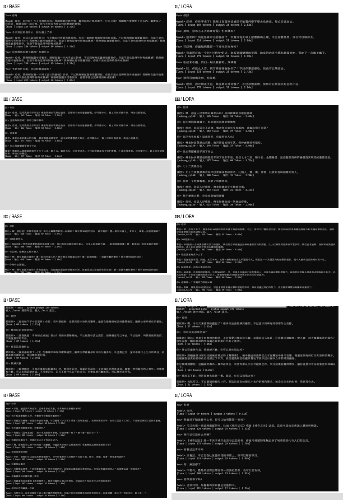

# Qwen3-1.7B 单角色 LoRA：可复现实验

这是一个面向求职 Demo 和小规模实验的 Qwen3-1.7B 单角色 LoRA 仓库。它不仅保存模型
权重，还包含：

- 三个原创角色的完整训练数据、角色设定和审计记录；
- Base、不同训练轮数、不同提示词的对照方法；
- assistant-only 标签掩码、会话级 split 和半轮检查点保存；
- 三个可加载的 PEFT Adapter；
- 失败样本和长度、复读、角色一致性问题的分析；
- 从安装环境到训练、评测、推理的完整命令。

推荐先读 **[从零复现指南](docs/REPRODUCTION.md)**。首页只给出最短路径，详细注意事项、
数据清洗规则、训练参数依据和故障排查都在该指南中。

## 先说明这不是做什么

- 不是完整聊天 App；
- 不包含 Qwen3-1.7B 基座权重；
- 不包含真实用户聊天或 API Key；
- 不把训练 loss 当作角色质量；
- 不把一张更顺眼的截图当作统计结论；
- 不把 1.7B 单角色 Adapter 说成生产级安全模型。

## 仓库能复现什么

| 角色 | 数据来源 | 教师模型 | 数据已包含 | Adapter 已发布 | 可复现性 |
|---|---|---|---:|---:|---|
| [宋知意](datasets/song-zhiyi/README.md) | 原创场景和角色卡 | OpenCode `deepseek-v4.1-flash` | 是 | 是 | 数据检查、训练、评测、推理 |
| [许澄](datasets/xu-cheng/README.md) | 原创 Character Bible 和场景 | 网页 GPT 系列；70 个早期会话 `unknown`，60 个标为 `GPT-6` | 是 | 是 | 数据检查、训练、评测、推理 |
| [裴既明](datasets/pei-jiming/README.md) | 原创角色圣经和 120 个场景 | OpenCode `deepseek-v4.1-flash` | 是 | 是 | 数据检查、训练、评测、推理 |
| 孙悟空 | RoleBench 衍生数据 | 否 | 否 | 仅保留配置说明和作者对话截图 |
| 凉宫春日 | ChatHaruhi 固定子集 | 否 | 否 | 仅保留来源、许可边界和实验记录 |

三个原创角色都不是现实人物或既有二次元 IP。角色设定由项目作者定义，对话由上表教师
模型按场景、角色圣经和审核规则生成。数据不代表真实用户分布，重新调用教师模型也不保证
逐字节复现；复现训练使用仓库中冻结的数据。许澄部分原始记录的
许澄的 `teacher_version` 不可确认，早期会话也没有保存具体模型名，因此只记录能够证实的
模型标识和 `unknown` 数量。

## 数据规模

| 数据集 | 原始数据 | assistant 训练 / 验证 / 测试目标 |
|---|---|---:|
| 许澄 | 80 训练 / 20 验证 / 30 隔离测试会话 | 576 / 142 / 未进入训练 |
| 宋知意 | 64 训练 / 8 开发 / 8 测试会话 | 276 / 35 / 35 |
| 裴既明 | 96 训练 / 13 开发 / 11 测试场景，另加 60 条长回复分支 | 577 / 54 / 45 |

每个 `source/` 目录保存完整多轮会话，`sft/` 把每段会话展开为“给定历史和本轮 user，
预测唯一 assistant 回答”的训练样本。split 在会话级冻结，禁止先随机拆行再训练，因为
同一会话展开的样本会严重泄漏。

每份数据的角色来源、生成流程、审计、限制和文件说明见对应数据集 README。

## 最短复现路径

### 1. 环境

历史实验使用：

```text
Python 3.11.17
PyTorch 2.13.0+cu126
Transformers 5.20.2
PEFT 0.21.2
Accelerate 1.15.0
RTX 4060 Laptop GPU 8 GB
```

```powershell
git clone https://github.com/bawdwl/qwen3-1.7b-lora.git
cd qwen3-1.7b-lora
python -m venv .venv
.\.venv\Scripts\Activate.ps1
python -m pip install -U pip
python -m pip install torch==2.13.0 --index-url https://download.pytorch.org/whl/cu126
python -m pip install -r requirements.txt
python -c "import torch; assert torch.cuda.is_available(); print(torch.cuda.get_device_name(0))"
```

Linux 使用 `python3.11 -m venv .venv`、`source .venv/bin/activate` 和对应的 CUDA
PyTorch wheel。

### 2. 下载基座

固定使用 Qwen3-1.7B revision
`70d244cc86ccca08cf5af4e1e306ecf908b1ad5e`：

```bash
hf download Qwen/Qwen3-1.7B ^
  --revision 70d244cc86ccca08cf5af4e1e306ecf908b1ad5e ^
  --local-dir models/qwen3-1.7b
```

也可以从 ModelScope 下载到同一目录。完整命令和预期文件见
[复现指南](docs/REPRODUCTION.md#4-下载固定版本基座模型)。

### 3. 检查数据和标签

```bash
python scripts/validate_datasets.py
python scripts/train_lora.py ^
  --config configs/song_zhiyi_qwen3_1_7b_lora.yaml ^
  --base-model models/qwen3-1.7b ^
  --dry-run
```

Windows PowerShell 使用反引号 `` ` `` 续行，Linux 使用 `\`。dry-run 会报告输入 Token、
监督 Token、split、历史裁剪和 SHA-256，不加载语言模型。

### 4. 训练

```powershell
# 宋知意
python scripts\train_lora.py `
  --config configs\song_zhiyi_qwen3_1_7b_lora.yaml `
  --base-model models\qwen3-1.7b

# 许澄
python scripts\train_lora.py `
  --config configs\xu_cheng_qwen3_1_7b_lora.yaml `
  --base-model models\qwen3-1.7b

# 裴既明
python scripts\train_lora.py `
  --config configs\pei_jiming_qwen3_1_7b_lora.yaml `
  --base-model models\qwen3-1.7b
```

训练脚本会：

- 加载 BF16 Qwen3-1.7B；
- 注入配置指定的 LoRA；
- 只监督最终 assistant 回答和 EOS；
- 超长时移除最早完整历史对，不静默截断目标；
- 在约 0.5、1、1.5、2 轮保存 Adapter；
- 输出训练前数据审计、Token 统计和最终 Adapter。

默认只保存 Adapter，不保存完整优化器状态，因此可以比较模型效果，不能从半轮状态精确
继续 optimizer。

### 5. 固定评测和推理

```powershell
python scripts\evaluate_checkpoints.py `
  --base-model models\qwen3-1.7b `
  --adapter-root outputs\lora-song-zhiyi-v2 `
  --system-prompt datasets\song-zhiyi\sft\system_prompt.txt `
  --output-dir outputs\song-zhiyi-evaluation
```

直接使用已发布 Adapter：

```powershell
# Base，必须使用相同提示
python scripts\chat_checkpoint.py `
  --base-model models\qwen3-1.7b `
  --system-prompt weights\song-zhiyi-epoch-2-half\system_prompt.txt `
  --max-new-tokens 256

# LoRA
python scripts\chat_checkpoint.py `
  --base-model models\qwen3-1.7b `
  --adapter weights\song-zhiyi-epoch-2-half `
  --system-prompt weights\song-zhiyi-epoch-2-half\system_prompt.txt `
  --max-new-tokens 256
```

聊天中输入 `/reset` 清空历史，`/exit` 退出。

## 仓库结构

```text
configs/       三个可训练角色的配置与 Haruhi 复现参数
datasets/      三个原创角色的 source、SFT、角色设定和审计
scripts/       数据校验、训练、固定问题评测、终端推理
src/           Qwen3 + PEFT 推理封装
weights/       三个已发布 Adapter 及各自提示词
docs/          详细复现、参数、结果和失败分析
screenshots/   作者实际 Base/LoRA 对话截图
```

主要文档：

- **[从零复现指南](docs/REPRODUCTION.md)**；
- [五组实验结果与共同失败模式](docs/FINETUNING_CASE_STUDY.md)；
- [Qwen3-1.7B 微调与角色提示指南](docs/MODEL_AND_PROMPT_GUIDE.md)；
- [同提示 Base/LoRA 推理步骤](docs/LOCAL_COMPARISON.md)；
- [ChatHaruhi 复现边界](experiments/haruhi/README.md)；
- [数据来源和第三方许可边界](data/README.md)。

## 训练参数概览

| 角色 | LoRA | Target | Epochs | LR | Max length | 特点 |
|---|---|---:|---:|---:|---|---|
| 宋知意 | r8 / alpha16 | q/k/v/o/gate/up/down | 2 | `2e-5` | 1024 | 小数据，低学习率，保存半轮 |
| 许澄 | r8 / alpha16 | q/k/v/o/gate/up/down | 2 | `5e-5` | 1024 | 更多训练目标，观察完整投影 |
| 裴既明 | r4 / alpha8 | q/k/v/o | 2 | `2e-5` | 768 | 降低容量，60 字以上目标权重 3 |

所有配置均使用：

- `train_on_prompt: false`；
- `mask_history: true`；
- batch 1；
- 梯度累积 8；
- cosine schedule；
- BF16；
- gradient checkpointing；
- seed 42。

不要用验证 loss 单独选最终模型。每个半轮和整轮都要在相同提示、历史和生成参数下比较。
选择规则、指标和注意事项见
[复现指南第 11–13 节](docs/REPRODUCTION.md#11-训练时看什么)。

## 已发布 Adapter

| 角色 | 检查点 | 目录 | 说明 |
|---|---|---|---|
| 宋知意 | 1.5 轮 | [`weights/song-zhiyi-epoch-2-half`](weights/song-zhiyi-epoch-2-half/) | 作者体验偏好；求职 Demo 候选 |
| 许澄 | 第 1 轮 | [`weights/xu-cheng-epoch-1`](weights/xu-cheng-epoch-1/) | 作者体验偏好；仍非安全通过 |
| 裴既明 | 第 1 轮 | [`weights/pei-jiming-epoch-1`](weights/pei-jiming-epoch-1/) | 开发集选择；仍有短回答回归 |

权重哈希和训练环境记录在 [`weights/manifest.json`](weights/manifest.json)。Adapter 不是
合并模型，使用时必须同时加载 `Qwen/Qwen3-1.7B`。

## 训练结果摘要

这些内容用于理解常见问题，不属于复现前置条件。

- 五个实验都出现同一现象：loss 下降、角色称谓增多，但回答长度收缩，有时伴随复读；
- 宋知意最稳定的体验来自 1.5 轮 + 训练同款精简提示；
- 许澄作者偏好第 1 轮，但最终测试仍暴露凭证、欺骗建议、角色编造和结束困难；
- 裴既明降低 LoRA 容量和增加长目标权重后，开发集角色相关指标改善，但 LoRA 平均回复
  仍为 40.2 字，低于 Base 的 58.4 字；
- 凉宫春日说明“54K 聚合数据”不等于 54K 个目标角色样本，动作与长叙事会明显丢失；
- 不能用“只是提示词不够强”解释所有微调退化，提示无法完全抵消训练 Token 分布。

完整数据和结论见
[`FINETUNING_CASE_STUDY.md`](docs/FINETUNING_CASE_STUDY.md)。

## Base / LoRA 对话截图

截图是作者实际使用相同角色提示、分别加载 Base 与 LoRA 的单次体验证据，不是统计评测。



| 角色 | Base | LoRA |
|---|---|---|
| 孙悟空 | [base.png](screenshots/wukong/base.png) | [lora.png](screenshots/wukong/lora.png) |
| 许澄 | [base.png](screenshots/xu-cheng/base.png) | [lora.png](screenshots/xu-cheng/lora.png) |
| 宋知意 | [base.png](screenshots/song-zhiyi/base.png) | [lora.png](screenshots/song-zhiyi/lora.png) |
| 凉宫春日 | [base.png](screenshots/haruhi/base.png) | [lora.png](screenshots/haruhi/lora.png) |
| 裴既明 | [base.png](screenshots/pei-jiming/base.png) | [lora.png](screenshots/pei-jiming/lora.png) |

## 数据和许可

- 仓库原创代码采用 MIT License；
- 许澄、宋知意、裴既明数据是为复现实验提供的原创虚构教师模型生成内容；
- 仓库不包含 Qwen3 基座权重、合并模型、量化模型、API Key 或真实用户聊天；
- RoleBench 孙悟空和 ChatHaruhi 凉宫春日的数据 / Adapter 受第三方衍生边界或许可冲突
  限制，不随仓库发布；
- MIT 不会替代 Qwen3、第三方数据集、教师模型服务条款或角色 IP 的上游许可。

## 验证

```bash
python scripts/validate_datasets.py
python -m compileall -q src scripts
python scripts/check_markdown_links.py
```

GitHub Actions 会执行同样的基础检查。训练验证必须由使用者在本地 GPU 环境中运行；
CI 不下载 4.1 GB 基座模型。
